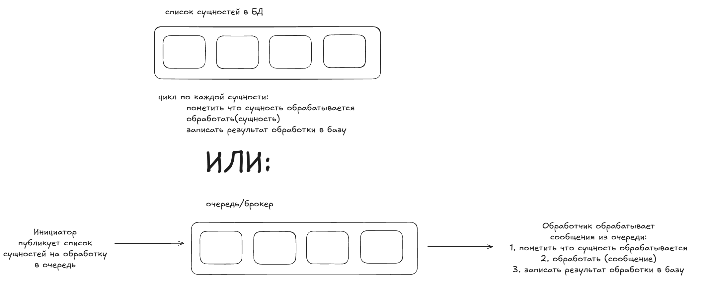

# Jobs

## Глоссарий

Джоба - код, который выполняется в фоне и запускается по триггеру/крону
Консюмер - сервис, читающий/принимающий сообщения от брокера/очереди
Sweeper или Sanity Check Job - регулярная фоновая джоба, проверяющая систему на логическую ценность и непротиворечивость данных (инварианты бизнес логики). Не обязательно чинит данные, иногда просто алертит
Компенсирующая транзакция - бизнес-действие, которое отменяет (компенсирует) изменения, внесенные предыдущей транзакцией, если весь процесс завершился ошибкой

## Концепция Job

Это единица асинхронной работы, которая имеет:

1. Payload - входные данные необходимые для выполнения (сериализованный json или объект в бд например)
2. Metadata - id задачи, время создания, приоритет, кол-во попыток, таймауты
3. State - где находится в жизненном цикле
4. Executor - код, превращающий payload в результат

## Message

Факт (event) или сигнал (пример - command в сервисе), который передается куда-либо синхронно или асинхронно

## Модель исполнения

In-process, Out-Of-Process, Distributes Worker Pool

## State Machine

Created/Enqueued, Scheduled, Acquired/Processing, Successed, Failed, Dead/Archived

## Оркестрация и триггеры

1. Event-driven (событийные) - триггер сообщение из шины
2. Time-driven (крон) - запуск по расписанию
3. Delayed-Scheduled - в очереди с отложенным выполнением
4. DAG (Directed Acyclic Graph) и Workflow: задача А запускает Б и В, когда обе закончат -запускает Г. Тут уже стоит посмотреть в сторону **Temporal**, или другой системы предназначенной для этого

## Observability

1. Structured Logging и Dixtributed Tracing

TraceId, JobId, TenantId

2. Метрики

Queue Depth: сколько задач в очереди - по дефолтну на уровне очереди
Processing Time (P95/P99) - из метрик апи ручек
Error rate - из метрик апи ручек
Retry Rate

## Batch и polling jobs

Batch job раз в 5 минут:

1. Взяли из бд все или X заказов со статусом EmailPending
2. Прошлись по каждому в цикле: отправляем письмо + update статуса в базе

Такую джобу можно заменить на event-driven подход, дальше рассмотрим что лучше

Polling/Retrival job раз в 5 минут:

1. Взять во внешней системе сущности с created_at > last_timestamp или с id > last_known_id
2. Сохранить к себе в базу

Такие джобы, к сожалению не заменить, тк мы не управляем триггером из внешней системы (подразумевается что мы работаем вообще с внешней системой, а не внутренним микросервисом, где можно договориться на event-driven через брокера. Примеры: с IMAP сервера забрать X непрочитанных сообщений, забрать из 1С новые счет-фактуры которые еще не видели, забрать из Битрикса новые логи времени)

## Work Queue на базе очереди (command-driven/command dispatch) vs job

Work Queue паттерн - архитектурный паттерн проектирования, в котором задачи (сообщения или работы) поступают в общую очередь (брокер, канал, список) и распределяются между несколькими параллельными исполнителями. Наиболее частая реализация - через RMQ или Kafka, тк они и так используются как шины и дают мониторинг: queue depth, error rate

Неудобства Batch Job:

1. Кастомный мониторинг над Queue Depth и Error Rate, в очередях у нас это есть из коробки
2. Много лишнего кода - try/catch на обработку каждого элемента, кастомное написание и хранение ретраев
3. Излишяя нагрузка на базу - тяжелые Select запросы вместо обработки по одному из брокера и блокировки FOR UPDATE/SKIP LOCKED, как следствие - распухший tempdb/bloat для MSSQL и Postgres соответственно
4. Если список обработки растет намного быстрее скорости обработки, batch job тяжело масштабировать

Вывод: не брать Batch job, когда нагрузка высокая, или когда на проекте уже есть брокер и ты можешь без проблем добавить туда work-queue

Когда взять Batch Job:

1. Простой крон или крон с аггрегацией (сгенерировать отчет раз в день, собрать данные за период и отправить сводный отчет). Для первого нет смысла тянуть брокер, для второго брокер не подходит тк не умеет ждать и накапливать
2. Когда интегрируемся с системой, где нет возможности через RMQ работать (раз в час забрать непрочитанные сообщения с IMAP)
3. На проекте нет брокера и нет возможности его тянуть
4. Небольшая нагрузка

Советы:

1. В интерфейсе админки всегда должна быть возможность сделать действие, если джоба не смогла этос выполнить автоматом. Пример: сгенерировать отчет через кнопку, если он автоматически в ЛК не подгрузился
2. Вне зависимости от выбора work-queue или job в UI всегда должны быть четкие статусы в каком состоянии находится процесс и сущность и возможность сделать действия джобы руками

### Decision Framework

1. Есть ли возможность заиспользовать брокер с внешней системой?
2. Сколько сущностей обрабатываем? (< 500 → Batch, > 500 → Work Queue)
3. Есть ли уже брокер в проекте? (Да → Work Queue, Нет → Batch или тянуть брокер)
4. Есть ли риск наложения запусков? (Да → Work Queue или Batch + distributed locks)

## Sync vs Async передача Command/Event

Задача 1:
Апи ручка для получения OTP кода на почту
Две возможные реализации:
Реализация 1: Отправка через SMTP/SendGrid, после INSERT в таблицу сессий: id сессии + хеш OTP кода
Реализация 2: Одновременно INSERT в таблицу сессий + в outbox табличку. Фоново вычитываем outbox и кладем в RMQ

Задача 2:
Апи ручка создания заявки с последующей отправка лидгена во внешний апи

Две возможные реализации:
Реализация 1. INSERT в свою бд заявок в статусе pending, запрос во внешний апи, update своей базы с id внешним и статусом Active. Фоновая джоба компенсирующей транзакции: посмотреть нет ли во внешнем апи заявок, что у нас как pending, чтобы перевести их в active

Реализация 2. INSERT в свою таблицу + в outbox. Фоновый джоб из outbox с запросом во внешний апи и обновлением локальной таблицы.

Правила:
Делаем СИНХРОННО (прямо в HTTP-ручке), если:

1. Внешний сервис работает мгновенно и это не рушит пользовательский опыт.
2. Нужна мгновенная реакция. Если внешний сервис упадет, текущая операция не имеет смысла (например, оплата картой: если банк упал, мы не можем сказать пользователю "покупка оформлена, ждите", мы должны сказать "оплата не прошла").
3. У нас нет своей БД, или мы не сохраняем состояние.
4. Действие не предполагает каскадных расширений (например создание заказа: отправить в кэшбек, отправить в сервис статистики и тд, это надо делать через брокер с fanout доставкой)

Делаем АСИНХРОННО (Outbox / Broker / Background), если:

1. Внешний сервис работает долго и это рушит пользовательский опыт.
2. Если внешний сервис упадет, мы можем отложить результат (пользователю не нужно ждать, мы просто сделаем это позже).

## Советы

### Всегда надо понимать, что джоба может упасть. Если какую-то логику можно сделать без джобы, то надо ее делать без джобы

Примеры:

1. Инвалидация кэша/read-model/in-memory кэша
Это можно реализовать либо через джобу инвалидации, что при падении джобы влечет за собой долгий невалидных кэш. Лучше в апи ручке добавить проверку условия и если кэш невалиден - синхронно под семафором/распределенной блокировкой его обновить

2. Перенос сущности в архив по простому правилу, например по времени/смене статуса
Допустим мы считаем сущности архивными/просроченными если они живут > 5 минут. Нужно добиться того, чтобы просроченные сущности не попадали на виртуальные полки на сайте
Два варианта решения:
Джоба которая выставляет флаг is_archived на товары больше 5 минут
В апи ручке в Select запросе просто не берет такие товары

Но нужно понимать что если назгрузка большая и добавление этого условия не позволит нормально работать индексам/read-model не получится нормально организовать - перенести в джобу

### У операции всегда должен быть статус в БД

Мы не должны знать о статусе операции только исходя из того, лежит операция в outbox/очереди/dlq, это антипаттерн

Пример:
Есть процесс отправки email при создании заказа. Это происходит через outbox и RMQ. Обязательно у сущности товара должен быть статус отправки Email пользователю, чтобы через UI можно было видеть, где не отправлен Email и делать повторные отправки

## TODO

1. Разобраться с тем, какие есть в .net готовые решения и их слабые стороны (Hangfire - не поставить джобу на паузу, не видно какой Payload был на входе джобы; Quartz - нет UI, сложноват; разобраться с TickerQ)
2. Написать свою систему джоб - MVP