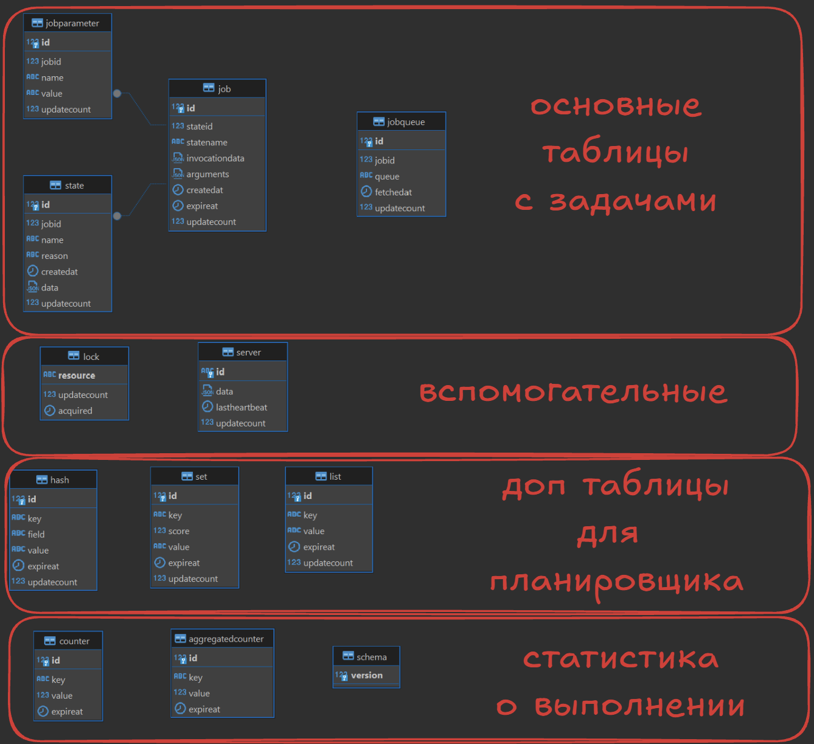
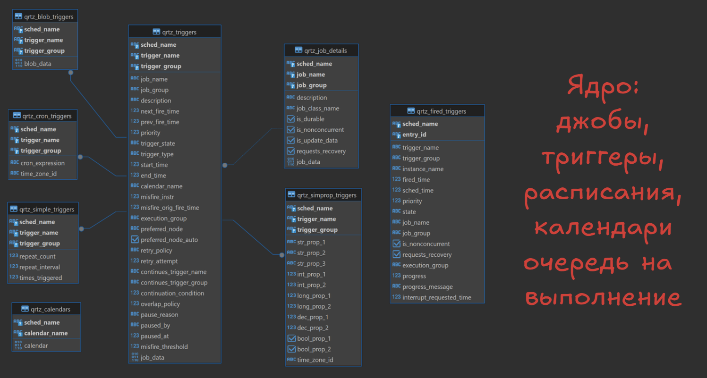
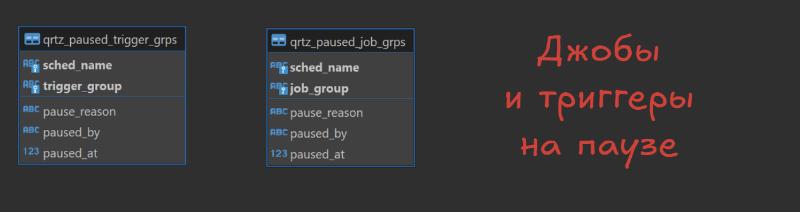
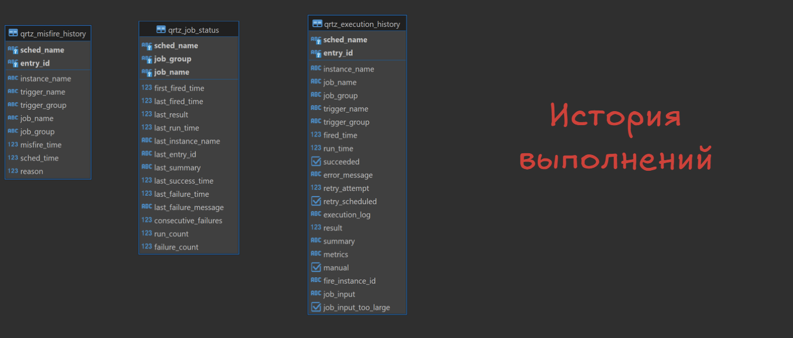
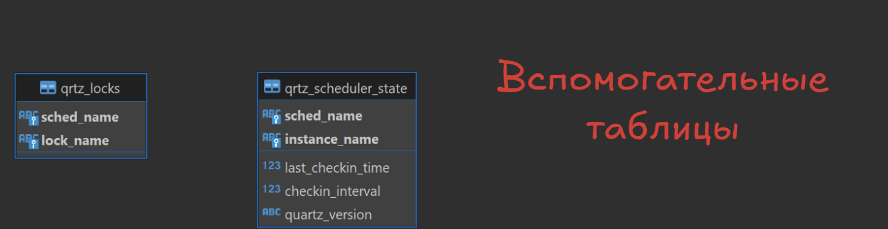

# Jobs Playground: Hangfire vs Quartz.NET

opencode -s ses_e86630995ffe2ay5iiscorTgQT

- **Hangfire** — очередь заданий и машина состояний;
- **Quartz.NET** — планировщик с заданиями, триггерами и расписаниями (очередь тоже есть)

Оба приложения используют PostgreSQL, но хранят состояние по-разному.

Одинаковые сценарии (письмо сразу, отложенное письмо, повторяющаяся задача) реализованы в двух отдельных приложениях, чтобы можно было сравнить не только API, но и схему БД, поведение при сбоях,
паузу, повторы и диагностику.

## Содержание

- [Что внутри](#что-внутри)
- [Стек](#стек)
- [Запуск](#запуск)
- [Сценарии и API](#сценарии-и-api)
- [Концепция: две разные модели](#концепция-две-разные-модели)
- [Схема БД и C4 схемы](#схемы-бд-и-c4-схемы)
- [Практический разбор Quartz](#практический-разбор-quartz)
- [Retry и backoff](#retry-и-backoff)
- [Пауза, отмена и конкурентность](#пауза-отмена-и-конкурентность)
- [Сравнительная таблица](#сравнительная-таблица)
- [Ограничения демо](#ограничения-демо)
- [Сброс и диагностика](#сброс-и-диагностика)

## Что внутри

| Компонент | Назначение |
|---|---|
| `JobsDemo.Hangfire` | ASP.NET Core minimal API + Hangfire Server + Hangfire Dashboard |
| `JobsDemo.Quartz` | ASP.NET Core minimal API + Quartz Scheduler + Quartz Dashboard |
| `JobsDemo.Shared` | Общие контракты БД и сервисов |

Демо отвечает на вопросы:

- как выглядит одна и та же задача в queue-модели и в scheduler-модели;
- какие таблицы создаёт каждая библиотека, как с ними работают use-cases и фоновые side-effects самих библиотек;
- где хранится расписание, очередь, история и состояние;
- как работают retry, пауза, отмена и защита от параллельного запуска;

## Стек

- Hangfire:
  - `Hangfire.AspNetCore` 1.8.25
  - `Hangfire.PostgreSql` 1.21.1
- Quartz:
  - `Quartz.AspNetCore` 4.6.0
  - `Quartz.Dashboard` 4.6.0

## Запуск

| Сервис | URL |
|---|---|
| PostgreSQL из docker-compose | `localhost:5433` |
| Hangfire UI | `http://localhost:5081` |
| Hangfire Dashboard | `http://localhost:5081/hangfire` |
| Quartz UI | `http://localhost:5082` |
| Quartz Dashboard | `http://localhost:5082/quartz` |
| Quartz HTTP API | `http://localhost:5082/quartz-api/schedulers` |
| Health check | `/api/health` на каждом приложении |

## Сценарии и API

### Hangfire

| Сценарий | Endpoint |
|---|---|
| Задание сразу в очередь | `POST /api/hangfire/fire-and-forget` |
| Отложенное задание | `POST /api/hangfire/delayed` |
| Немедленный запуск recurring-задачи | `POST /api/hangfire/recurring/hourly-digest/trigger` |
| Сводка для UI | `GET /api/hangfire/summary` |

Recurring-задача `hourly-digest` регистрируется при старте приложения и выполняется по cron `0 * * * *` в UTC. Очередь называется `emails`; сервер обрабатывает очереди `default` и `emails`.

### Quartz

| Сценарий | Endpoint |
|---|---|
| Одноразовый запуск через simple trigger | `POST /api/quartz/one-off` |
| Создать cron-подписку | `POST /api/quartz/cron` |
| Запустить cron-задачу немедленно | `POST /api/quartz/cron/{id}/trigger` |
| Поставить триггер на паузу | `POST /api/quartz/cron/{id}/pause` |
| Снять с паузы | `POST /api/quartz/cron/{id}/resume` |
| Удалить job и trigger | `DELETE /api/quartz/cron/{id}` |
| Сводка для UI | `GET /api/quartz/summary` |

Встроенные задачи Quartz:

- `heartbeat` / `heartbeat-trigger` — cron `0/30 * * * * ?`, пишет строку в журнал каждые 30 секунд;
- `hourly-digest` / `hourly-digest-trigger` — cron `0 0 * * * ?`, часовой дайджест.

## Концепция: две разные модели

### Hangfire: очередь и состояние

Hangfire представляет работу как задание (job), которое перемещается по состояниям:

```text
Enqueued -> Processing -> Succeeded
                    \-> Failed -> Retry -> Enqueued
```

- Клиент создаёт задание и оно помещается его в очередь (jobqueue).
- Hangfire Server забирает задание из очереди и выполняет метод.
- Состояние задания и история переходов сохраняются в БД (state).
- Recurring job — это не отдельный worker, а запись расписания (set), которая периодически порождает обычные задания.
- Отложенное задание — это задание с временем, раньше которого его нельзя забрать.

Ключевая идея: **сначала задание, потом время его выполнения**. Очередь — центральное понятие.

### Quartz: расписание и триггеры

Quartz разделяет описание работы и правило её запуска:

```text
JobDetail (что делать)
    |
    +-- Trigger (когда делать)
          +-- SimpleTrigger: один раз или с интервалом
          +-- CronTrigger: календарное расписание
```

- `JobDetail` описывает класс задания и его данные.
- `Trigger` хранит следующее и предыдущее время срабатывания, состояние и политику misfire.
- Планировщик выбирает сработавшие триггеры, создаёт firing и выполняет job.
- `qrtz_fired_triggers` содержит активные выполнения, `qrtz_scheduler_state` — heartbeat узлов,
  `qrtz_locks` — блокировки для кластера.
- После выполнения trigger остаётся в store и ждёт следующего срабатывания, если расписание
  повторяющееся.

Ключевая идея: **сначала расписание, потом экземпляр работы**. Время — центральное понятие.

### Что общего

- Обе библиотеки используют PostgreSQL как durable store.
- Обе поддерживают фоновые, отложенные и повторяющиеся задачи.
- Обе умеют retry
- Обе дают dashboard и историю выполнения.

## Схемы БД и C4 схемы

### Общая картина

```text
PostgreSQL :5433
├── hangfire_demo
│   ├── hangfire.*          <- таблицы Hangfire
│   └── public.demo_activity <- журнал приложения
└── quartz_demo
    ├── public.qrtz_*       <- таблицы Quartz
    └── public.demo_activity <- журнал приложения
```

`postgres/init/01-init.sql` создаёт только базы. Схемы библиотек создаются приложениями:

- Hangfire: `PrepareSchemaIfNecessary = true`, `SchemaName = "hangfire"`;
- Quartz: `ProvisionSchema()`, `TablePrefix = "qrtz_"`.

### Hangfire

Hangfire создаёт отдельную схему `hangfire`. Схема


 
Ключевые таблицы:

| Таблица | Роль |
|---|---|
| `job` | Одна строка на задание: сериализованный вызов, аргументы, текущее состояние, срок хранения |
| `state` | История состояний задания; последняя строка — текущее состояние (read-model есть в job табличке) |
| `jobparameter` | Параметры задания (cultureInfo для всех job, recurring - recurringJobId + Time) |
| `jobqueue` | Очередь: задания, ожидающие worker; `fetchedat` — момент захвата |
| `server` | Зарегистрированные серверы Hangfire и их heartbeat |
| `set` | Sorted set: отложенные задания, набор recurring-задач и времени их следующего выполнения (score) и другие доп данные |
| `hash` | Hash: определения recurring-задач и служебные метаданные |
| `list` | Списки на выполнение (сейчас не используется самим hangfire) |
| `counter` | Счётчики различных событий (джоба выполнилась, провалилась и тд). Временно хранит у себя значения, после это переезжает фоново в aggregatecounter |
| `aggregatedcounter` | Агрегированные счётчики (для отображения общей статистики по дням/неделям). 'stats:succeeded:2023-10-27-14'  - почасовая статистика, 'stats:succeeded:2023-10-27' - суточная статистика |
| `lock` | Распределённые блокировки между нодами кластера |
| `schema` | Версия схемы Hangfire |

Важно: recurring-задачи Hangfire не лежат в отдельной таблице «recurring_jobs». Они представлены записями в `hash`/`set`, из которых планировщик создаёт обычные задания.

В hash лежат метаданные о recurring задачах: очередь, крон, id time зоны (utc например), информация о самой джобе (тоже что лежит в job.invocationdata), время создания, последний запуск, следующий запуск, id последней джобы

Отложенные задания также используют `set` со score, равным времени запуска.

Связи `job -> state` и `job -> jobparameter` — реальные foreign keys. Связь `jobqueue -> job` логическая: очередь хранит `jobid`, но не обязана иметь FK.

Мне вообще не зашла схема Hangfire: куча неявных понятий, ужасные нейминги. Из этих понятий и неймингов без контекста невозможно понять какие есть use-cases и фоновые сайд-эффекты от них.

### Quartz

https://chat.deepseek.com/a/chat/s/93d3d43c-408e-4a5a-b151-c03c2b300a10









Ключевые таблицы:

| Таблица | Роль |
|---|---|
| `qrtz_job_details` | Определение job: класс, группа, durable/nonconcurrent, job data (данные на вход) |
| `qrtz_triggers` | Общие поля триггера: джоба, следующее/предыдущее срабатывание, приоритет, состояние (normal/paused/complete/blocked/waiting), тип, misfire политика |
| `qrtz_simple_triggers` | Параметры simple trigger: repeat count, interval, сколько раз сработал |
| `qrtz_cron_triggers` | Cron-выражение и timezone |
| `qrtz_simprop_triggers` | Дополнительные свойства trigger (str, int, long, dec, bool) |
| `qrtz_blob_triggers` | Сериализованный trigger, наследованный от ITrigger для нестандартных типов |
| `qrtz_fired_triggers` | Активные выполнения: instance, trigger, job, fired time, state (Acquired, Executing, Blocked) |
| `qrtz_calendars` | Календари исключений (праздники, окна maintenance) |
| `qrtz_paused_trigger_grps` | Группы триггеров на паузе |
| `qrtz_paused_job_grps` | Группы job на паузе |
| `qrtz_scheduler_state` | Heartbeat экземпляров планировщика для кластера |
| `qrtz_locks` | Блокировки, которые удерживает scheduler instance |
| `qrtz_execution_history` | История выполнений и попыток: job, trigger, fired_time, success, error, retry attempt, metrics |
| `qrtz_misfire_history` | История пропущенных/опоздавших срабатываний: trigger, job, misfire_time, sched_time |
| `qrtz_job_status` | Агрегат по job: число запусков, failures, last запуск, consecutive failures |

Колонки `retry_policy` и `retry_attempt` находятся прямо в `qrtz_triggers`. История `qrtz_execution_history` дополнительно хранит `retry_attempt`, `retry_scheduled`, `succeeded`,
`error_message`, `result` и `metrics`. Поэтому retry в Quartz виден и в dashboard, и в SQL.

Включённые в приложении настройки:

```csharp
store.UsePostgres(connectionString);
store.UseExecutionHistory();   // qrtz_execution_history, qrtz_misfire_history, qrtz_job_status
store.ProvisionSchema();       // создаёт недостающие qrtz_* таблицы
store.ConfigureStore(options =>
{
    options.TablePrefix = "qrtz_";
    options.StoreJobDataAsStrings = true;
});
```

`StoreJobDataAsStrings = true` упрощает чтение job data из SQL и dashboard: данные хранятся как строки, а не как трудночитаемый binary blob.

Связи:

- `qrtz_triggers` имеет FK на `qrtz_job_details`;
- `qrtz_cron_triggers` и `qrtz_simple_triggers` имеют FK на `qrtz_triggers`;
- `qrtz_execution_history` и `qrtz_job_status` связаны с job/trigger логически по
  `sched_name`, `job_name`, `job_group`, `trigger_name`, `trigger_group`, без жёстких FK.

## Quartz и Hangfire сравнение концепций

Типы джоб тоже одинаковые: fire-and-forget в hangfire (в quartz это еще и simpleTriggers где можно несколько раз выполнить с интервалом), delayed в Hangfire (в quartz - это simple trigger с next-fire-time), и recurring (и там и там один механизм с кроном)
просто quartz более удачно все это по таблицам разложил (в отличии от hangfire, где никаких contstaint даже нормально не наложишь на таблички hash, set)

И там и там есть очередь выполнения - jobqueue и fired_triggers

в quartz сверху добавляется разделение джобы и триггера (в hangfire этого нет и там это слито все в job и hash таблицах)

В quartz еще сверху можно оставновить джобу и триггер (что странно ведь вы сами разделили джобу и триггер, логично только триггер останавливать, при этом в таблицах paused_jobs и paused_triggers пусто даже когда ставишь на паузу)

Также в Quartz добавляется возможность наложить календарь на триггер, дабы наложить ограчения (имхо это проще и лучше в коде реализовать)

История выполнений и misfire в quartz, в hangfire - aggregated counter и job несут эту роль

### Hangfire

```
Не запустил hangfire server и сделал fire-and-forget (23) и delayed (24, 25)

появились записи в job (FaF сразу в состоянии enqueued и записана в jobqueue, delayed в состоянии scheduled но в jobqueue ничего нет)
в set появились только для job 24 и 25 с их score
hash пустой тк там похоже только recurring 
list пустой

после запуска HangfireServer:
job: FaF - successed (не удалилась, expire at - 1 ноября). delayed - succesed
set - удалились для delayed job записи
jobqueue - пустой

выводы:
1. set - табличка расписаний когда надо выполнять такие-то джобы (recurring и scheduled)
2. hash - хранилище основной информации 

мысли:
- почему в jobparameter не запихнуть было, то что в hash для recurring job
- как будто если в hash лежит инфа в таком виде и там лежит инфа о состоянии джобы, то можно в Hash добавить еще один key отвечающий за то, активна она или нет
- почему у hf нет тогда возможности крон менять в ui, нет 


сразу в кишки:
1. AddHangfireServer - добавляет BackgroundJobServerHostedService как IHostedService
```

### Quartz

```
выключил хост quartz
создал задачу one-off-9fcdec51 - one-off

создалась в job-details
оздалась в triggers с next_fire_time и prev_fire_time = null, trigger_type = simple и trigger_state = waiting
создалась в simple-triggers с repeat_count, repeat_interval, times_triggered = 0

после включения хоста quartz и выполнения запись отовсюду пропала
```

## Практический разбор Quartz

### Два UI и один scheduler

В демо есть два интерфейса:

| UI | Что это |
|---|---|
| `http://localhost:5082` | Наша кастомная панель. Ходит в `/api/quartz/*`, вызывает `IScheduler` и читает `demo_activity` |
| `http://localhost:5082/quartz` | Нативный `Quartz.Dashboard`. Работает с тем же scheduler и persistent store |
| `http://localhost:5082/quartz-api` | Нативный Quartz HTTP API, смонтированный через `MapQuartzHttpApi` |

### Маршрут выполнения

Упрощённый путь одного срабатывания:

```text
QuartzSchedulerThread
  -> спрашивает job store: какие trigger пора запускать
  -> резервирует trigger в qrtz_fired_triggers
  -> берёт поток из пула
  -> вызывает IJob.Execute
  -> обновляет qrtz_triggers: prev_fire_time, next_fire_time, state
  -> пишет qrtz_execution_history и qrtz_job_status
  -> удаляет transient-запись из qrtz_fired_triggers
```

В коде это включается так:

```csharp
builder.AddQuartz(configure =>
{
    configure.UsePersistentStore(store =>
    {
        store.UsePostgres(connectionString);
        store.UseExecutionHistory();
        store.ProvisionSchema();

        store.ConfigureStore(options =>
        {
            options.TablePrefix = "qrtz_";
            options.StoreJobDataAsStrings = true;
        });
    });

    configure.AddJob<HeartbeatJob>(...);
    configure.AddTrigger<HeartbeatJob>(...);
    configure.AddJob<SendEmailJob>(...);
    configure.AddTrigger<SendEmailJob>(...);
});

builder.AddQuartzHostedService(options => options.WaitForJobsToComplete = true);
```

- `UsePostgres` переключает store на PostgreSQL.
- `ProvisionSchema` создаёт недостающие `qrtz_*` таблицы.
- `UseExecutionHistory` включает историю, misfire-историю и агрегаты по job.
- `AddJob` создаёт `JobDetail`.
- `AddTrigger` создаёт trigger и связывает его с job.
- `AddQuartzHostedService` стартует scheduler вместе с приложением.

### Что показывает dashboard

#### Dashboard

Главная страница `/quartz`:

- **Scheduler status** — `Running`;
- **Start / Standby / Pause all / Resume all / Shutdown** — управление scheduler;
- **Total Jobs / Total Triggers** — количество `JobDetail` и trigger;
- **Currently Executing** — активные выполнения;
- **Error Triggers** — trigger в состоянии ошибки;
- **Nodes** — узлы кластера; в некластерном режиме cluster-страница сообщает, что кластера нет;
- **Paused Groups** — паузы на группах;
- **Misfires (last 24 h)** — пропущенные срабатывания;
- **Trigger states** — Normal / Paused / Blocked / Error / Complete;
- **Execution groups** — лимиты одновременных выполнений;
- **Recent admin actions** — действия, сделанные через панель.

`Standby` перестаёт забирать trigger из store, но процесс продолжает работать. `Shutdown` останавливает scheduler; в демо лучше не нажимать без необходимости.

#### Jobs

`/quartz/jobs`:

- job сгруппированы по `job_group`: `emails`, `maintenance`, `one-off`, `cron-emails`;
- для каждого job видно последний запуск и признак failing;
- действия: Pause, Resume, Trigger now, Delete;
- действия на группе применяются ко всем job этой группы.

Страница job detail показывает:

- тип job, например `JobsDemo.Quartz.Jobs.SendEmailJob`;
- `Durable`, `Requests Recovery`, `Disallow Concurrent Execution`;
- последний запуск, последний успех/провал, количество запусков;
- графики runs/duration;
- **JobDataMap** — `scenario`, `to`, `subject`, `body`;
- запуск с override-значениями;
- связанные trigger.

Это проекция `qrtz_job_details`, `qrtz_job_status` и `qrtz_execution_history`.

#### Triggers

`/quartz/triggers`:

- фильтры по group/name/job/state/calendar/next fire;
- групповые Pause/Resume;
- строки с trigger key, state, execution group;
- действия Pause, Resume, Unschedule.

Trigger detail показывает:

- Type: `Cron` или `Simple`;
- Priority;
- Misfire Instruction: например, `SmartPolicy`;
- Schedule;
- Next Fire / Previous Fire;
- **Retry Policy** и **Retry Attempt**;
- Overlap Policy;
- JobDataMap;
- редактирование cron;
- ближайшие срабатывания;
- ссылку на execution history.

Это поля `qrtz_triggers` плюс специализированная таблица `qrtz_cron_triggers` или
`qrtz_simple_triggers`.

#### Calendars

`/quartz/calendars` — именованные календари Quartz. В демо пусто, потому что `qrtz_calendars`
не используется. Календарь позволяет исключать даты и интервалы, например праздники.

#### Executing

`/quartz/executing` — текущие выполнения из `qrtz_fired_triggers`. Сейчас пусто, потому что heartbeat выполняется очень быстро. Для долгой задачи здесь можно запросить interrupt; запрос отражается в `qrtz_fired_triggers.interrupt_requested_time`.

#### Schedulers

`/quartz/schedulers` — «флот» scheduler-ов:

- имя `QuartzScheduler`;
- instance id `NON_CLUSTERED`;
- job store `LocalTransactionJobStore persistent`;
- количество threads;
- версия Quartz;
- **Jobs executed** — счётчик текущего процесса, а не persistent-история.

#### Cluster

`/quartz/cluster`:

- сейчас пишет, что scheduler некластерный;
- `qrtz_scheduler_state` пустая;
- `qrtz_locks` пустая;
- в кластере здесь были бы узлы, last check-in, acquired/executing.

Важно: **persistent store ≠ cluster**. У нас есть persistence в PostgreSQL, но нет cluster coordination. Для кластера нужны уникальные instance id, check-in в `qrtz_scheduler_state` и распределённые блокировки в `qrtz_locks`.

#### History

`/quartz/history` — самая полезная страница для обучения:

- все запуски из `qrtz_execution_history`;
- фильтры по job, trigger, node, outcome, result и времени;
- success rate, longest run;
- графики;
- список запусков с duration/result/error;
- отдельная секция **Misfires** из `qrtz_misfire_history`.

В текущем запуске там несколько сотен строк, 100% succeeded и 0 misfires. Старые one-off и cron-запуски остаются в истории, даже если сами job уже удалены.

#### Live Logs

`/quartz/live` — поток событий scheduler-а:

- `JobExecuting`, `JobExecuted`;
- `TriggerFired`, `TriggerCompleted`;
- `TriggerMisfired`, `TriggerPaused`, `TriggerResumed`;
- `JobPaused`, `JobResumed`, `JobInterrupted`;
- `TriggerInError`, `SchedulerStateChanged`, `SchedulerError`.

Это live-поток, а не таблица БД.

#### Action Log

`/quartz/actions` — журнал административных действий панели. В текущем запуске пуст.

### Фактическое состояние БД

На момент проверки в `quartz_demo` было:

| Таблица | Содержимое |
|---|---|
| `qrtz_job_details` | 2 job: `emails.hourly-digest`, `maintenance.heartbeat` |
| `qrtz_triggers` | 2 trigger: `hourly-digest-trigger`, `heartbeat-trigger` |
| `qrtz_cron_triggers` | 2 cron-выражения |
| `qrtz_fired_triggers` | 0–1 transient-строк |
| `qrtz_scheduler_state` | 0, scheduler некластерный |
| `qrtz_locks` | 0, cluster locks не используются |
| `qrtz_paused_trigger_grps` | 0 |
| `qrtz_paused_job_grps` | 0 |
| `qrtz_misfire_history` | 0 |
| `qrtz_execution_history` | несколько сотен запусков |
| `qrtz_job_status` | 16 агрегатов, включая старые one-off/cron job |

Это снимок конкретного запуска: на чистой БД счётчики будут другими, а heartbeat добавляет новые строки каждые 30 секунд, пока trigger не на паузе.

`qrtz_job_details`:

```text
emails.hourly-digest    is_durable = false    job_data = JSON
maintenance.heartbeat   is_durable = false    job_data = null
```

`job_data` у `hourly-digest` читается как обычный JSON:

```json
{"scenario":"recurring-digest","to":"ops@example.com","subject":"Hourly digest","body":"Recurring job: the hourly digest was produced by Quartz."}
```

Это результат `StoreJobDataAsStrings = true`: данные удобно смотреть в SQL и в JobDataMap.

`qrtz_triggers`:

```text
hourly-digest-trigger    PAUSED    CRON    retry_policy = null    retry_attempt = 0
heartbeat-trigger        PAUSED    CRON    retry_policy = null    retry_attempt = 0
```

В этом запуске оба trigger были переведены в `PAUSED` после экспериментов, поэтому история
перестала расти. До паузы `hourly-digest-trigger` обычно был `WAITING`, а `heartbeat-trigger`
периодически попадал в `ACQUIRED` на время выполнения.

`qrtz_cron_triggers`:

```text
hourly-digest-trigger    0 0 * * * ?      Russian Standard Time
heartbeat-trigger        0/30 * * * * ?   Russian Standard Time
```

Важные детали:

- `WAITING` — trigger ждёт следующего срабатывания.
- `ACQUIRED` — trigger уже зарезервирован scheduler-потоком под ближайшее выполнение.
  Dashboard показывает такие trigger-ы как `Normal`, а активные выполнения — отдельно.
- `PAUSED` — trigger не срабатывает до Resume; это состояние самого trigger, а не всей группы.
- `retry_policy = null` и `retry_attempt = 0`, потому что retry в демо не включён.
- `misfire_instr = 0` — это `SmartPolicy`.
- `next_fire_time` и `prev_fire_time` хранятся как `bigint` с .NET ticks, а не как `timestamp`.
  Dashboard переводит их в дату.
- Cron в этом запуске считается в локальной timezone `Russian Standard Time`, потому что
  `WithCronSchedule(...)` вызван без `TimeZoneInfo`. Для UTC нужно явно передать
  `TimeZoneInfo.Utc`.

### Жизненный цикл one-off job

Проверка на живом приложении: создали one-off с задержкой 10 секунд.

Сразу после создания:

- `qrtz_job_details` — появилась строка `one-off-9e937477`, `is_durable = false`;
- `qrtz_triggers` — появился trigger `one-off-9e937477`, `trigger_type = SIMPLE`;
- `qrtz_simple_triggers` — появилась строка с `repeat_count = 0`, `repeat_interval = 0`.

Через 10 секунд:

- `qrtz_job_details` — строка исчезла;
- `qrtz_triggers` — строка исчезла;
- `qrtz_simple_triggers` — строка исчезла;
- `qrtz_execution_history` — запись осталась;
- `qrtz_job_status` — агрегат остался.

Почему job удалился: `JobDetail` был non-durable и имел только один trigger. Quartz удалил job после выполнения, но историю и агрегат сохранил. Именно поэтому dashboard может показывать в History больше job, чем в списке Jobs.

### Как действия dashboard связаны с БД

| Действие | Что меняется |
|---|---|
| Pause trigger | `qrtz_triggers.trigger_state = PAUSED` |
| Resume trigger | обратно в `WAITING` |
| Pause group | запись в `qrtz_paused_trigger_grps` или `qrtz_paused_job_grps` |
| Trigger now | внеочередное firing: `qrtz_fired_triggers`, затем `qrtz_execution_history` |
| Unschedule | удаляется trigger; job остаётся, если он durable |
| Delete job | удаляются job и его trigger; история/агрегаты могут остаться |
| Standby | scheduler перестаёт забирать trigger, процесс жив |
| Shutdown | scheduler останавливается |

### Что важно не перепутать

- `qrtz_execution_history` — persistent-история Quartz.
- `qrtz_job_status` — агрегаты, которые живут дольше самих job.
- `qrtz_fired_triggers` — только текущие выполнения, transient.
- `qrtz_scheduler_state` и `qrtz_locks` — cluster-механика, не «очередь».
- `NON_CLUSTERED` не означает «без persistence».
- `Jobs executed` на странице Schedulers — счётчик процесса, а не число строк в history.
- Наличие таблиц `qrtz_execution_history` и `qrtz_job_status` означает, что включён
  `UseExecutionHistory()`, а не что job обязательно выполнился успешно.

### SQL для самостоятельной проверки

Текущие job:

```sql
select job_name, job_group, is_durable, length(job_data) as job_data_bytes
from qrtz_job_details
order by job_group, job_name;
```

Trigger-ы:

```sql
select trigger_name, trigger_group, job_name, trigger_state,
       trigger_type, retry_policy, retry_attempt, misfire_instr
from qrtz_triggers
order by trigger_group, trigger_name;
```

Cron:

```sql
select trigger_name, trigger_group, cron_expression, time_zone_id
from qrtz_cron_triggers
order by trigger_group, trigger_name;
```

История:

```sql
select job_name, trigger_name, succeeded, retry_attempt,
       to_char(
           to_timestamp((fired_time - 621355968000000000) / 10000000.0)
               at time zone 'Europe/Moscow',
           'YYYY-MM-DD HH24:MI:SS'
       ) as fired_msk
from qrtz_execution_history
order by fired_time desc
limit 20;
```

Агрегаты:

```sql
select job_name, job_group, run_count, failure_count,
       consecutive_failures, last_result
from qrtz_job_status
order by job_group, job_name;
```

### Что попробовать руками

1. В `/quartz/jobs` нажать **Pause** у `heartbeat` (если уже `PAUSED` — сначала **Resume**),
   затем проверить:
   ```sql
   select trigger_name, trigger_state
   from qrtz_triggers
   where trigger_name = 'heartbeat-trigger';
   ```
   Будет `PAUSED`. После **Resume** снова станет `WAITING`.

2. Создать one-off на `/` с задержкой 20 секунд и параллельно смотреть:
   ```sql
   select job_name, job_group, is_durable from qrtz_job_details;
   select trigger_name, trigger_state, trigger_type from qrtz_triggers;
   select * from qrtz_simple_triggers;
   ```
   До запуска строки есть, после — job/trigger/simple trigger исчезнут, а history останется.

3. Добавить cron-подписку и посмотреть `qrtz_cron_triggers.cron_expression`.

4. Открыть `/quartz/history` и сравнить с последними строками `qrtz_execution_history`.

## Retry и backoff

### Hangfire

В демо retry задан атрибутом на методах `EmailJobs`:

```csharp
[Queue("emails")]
[AutomaticRetry(Attempts = 3, OnAttemptsExceeded = AttemptsExceededAction.Fail)]
public async Task SendWelcomeEmail(SendEmailRequest request)
{
    await SendAsync("fire-and-forget", request);
}
```

- Hangfire умеет retry «из коробки»; по умолчанию атрибут делает до 10 попыток.
- В демо число попыток уменьшено до 3, а после исчерпания задание остаётся в состоянии `Failed`.
- Задержки между попытками настраиваются через `AutomaticRetry`; в демо они не переопределены.
- История переходов и причины ошибок видны в `hangfire.state` и в Hangfire Dashboard.

### Quartz.NET 4.6

В текущем демо Quartz retry **не включён**: у `SendEmailJob` нет `[RetryPolicy]`, и нет сценария с искусственным сбоем. Это не ограничение Quartz 4.6 — библиотека подерживает retry/backoff, но политика по умолчанию отсутствует (`DefaultRetryPolicy = null`).

Включить retry можно на трёх уровнях (приоритет сверху вниз):

1. На конкретном trigger:

```csharp
TriggerBuilder.Create()
    .WithIdentity("digest-trigger", "emails")
    .ForJob(jobKey)
    .WithCronSchedule("0 0 * * * ?")
    .WithRetryPolicy(RetryPolicy.Exponential(
        maxAttempts: 3,
        initialDelay: TimeSpan.FromSeconds(2),
        factor: 2.0,
        maxDelay: TimeSpan.FromSeconds(8)))
    .Build();
```

2. На типе job:

```csharp
[RetryPolicy(3, "00:00:02", 2.0, MaxDelay = "00:00:08")]
public sealed class SendEmailJob : IJob
{
    public async ValueTask Execute(
        IJobExecutionContext context,
        CancellationToken cancellationToken = default)
    {
        var attempt = context.RetryAttempt; // 0 на обычном запуске, n на n-м retry
        var policy = context.RetryPolicy;   // эффективная политика для этого firing

        // ...
    }
}
```

3. Как default для scheduler:

```csharp
builder.AddQuartz(configure =>
{
    configure.UseDefaultRetryPolicy(
        RetryPolicy.Fixed(maxAttempts: 2, delay: TimeSpan.FromSeconds(5)));

    // ...
});
```

Доступные фабрики политики:

- `RetryPolicy.Fixed(attempts, delay)` — одинаковая задержка;
- `RetryPolicy.Exponential(attempts, initialDelay, factor, maxDelay, jitter)` — растущая задержка;
- `RetryPolicy.Explicit(delays)` — явная таблица задержек;
- `RetryPolicy.None` — не повторять (и запретить наследование политики).

Семантика:

- `MaxAttempts` считает **повторы после первого падения**, а не общее число запусков.
  `Fixed(2, ...)` означает до трёх выполнений: первое + два retry.
- `RetryAttempt` равен `0` на обычном запуске и `n` на n-м retry.
- Retry не вытесняет следующее плановое срабатывание: если retry попадает на него или
  почти на него, побеждает обычное расписание.
- Можно включить `configure.PauseTriggerWhenRetriesExhausted()`, чтобы после исчерпания
  попыток trigger встал на паузу, а не продолжал падать по расписанию.
- `RetryPolicy` хранится в `qrtz_triggers.retry_policy`; попытка — в `retry_attempt`.
  История попыток попадает в `qrtz_execution_history`.

## Пауза, отмена и конкурентность

### Пауза

Hangfire:

- можно поставить на паузу/остановить сервер, но не отдельное выполняющееся задание;
- recurring-задачу можно удалить или не создавать, а выполнение — поставить в очередь заново;
- нет отдельного API «pause this running job».

Quartz:

- `PauseTrigger`, `PauseJob`, `PauseJobs`, `PauseTriggerGroup`, `Standby` — на уровне
  триггера, job, группы или всего планировщика;
- пауза не останавливает уже запущенный job, а запрещает следующие срабатывания;
- состояние паузы хранится в `qrtz_triggers`, `qrtz_paused_trigger_grps`, `qrtz_paused_job_grps`.

### Отмена выполняющегося задания

Hangfire:

- отмена кооперативная, через `CancellationToken`;
- токен отменяется при shutdown или при смене состояния задания (например, `Delete`/`Requeue`);
- принудительно убить поток нельзя; задание должно само проверять токен.

Quartz:

- `Interrupt(jobKey)` и `InterruptFireInstance(fireInstanceId)` запрашивают отмену;
- job должен принимать `CancellationToken` и проверять его;
- `IInterruptableJob` в 4.6 не используется; современный путь — `CancellationToken` из
  `IJobExecutionContext`;
- запрос на interrupt виден в `qrtz_fired_triggers.interrupt_requested_time`.

В обоих случаях это **cooperative cancellation**, а не жёсткое завершение процесса.

### Защита от параллельного запуска

- Hangfire: `[DisableConcurrentExecution(timeoutInSeconds: 30)]` — распределённая блокировка
  на время выполнения; в демо применена к `SendHourlyDigest`.
- Quartz: `[DisallowConcurrentExecution]` на классе job; дополнительно есть execution groups
  и overlap policy. В демо явно не настроено, потому что задачи короткие и не пересекаются.

## Сравнительная таблица

| Критерий | Hangfire 1.8 | Quartz.NET 4.6 |
|---|---|---|
| Основная модель | Очередь заданий + state machine | Планировщик + job/trigger + очередь заданий |
| Единица работы | Метод/класс, сериализованный вызов | `IJob` + `JobDetail` |
| Запуск сразу | `Enqueue` | `SimpleTrigger` с `StartNow()` |
| Отложенный запуск | `Schedule` | `StartAt` |
| Повторяющаяся задача | `AddOrUpdate` + cron | `CronTrigger` |
| Retry | Встроенный `AutomaticRetry`, по умолчанию 10 попыток; в демо 3 | `RetryPolicy` / `[RetryPolicy]`; opt-in, по умолчанию нет |
| Backoff | Настраиваемые задержки | Fixed / Exponential / Explicit, max delay, jitter |
| Пауза job/trigger | Нет отдельной паузы выполняющегося job | `PauseTrigger` / `PauseJob` / группы / `Standby` |
| Отмена выполнения | Кооперативный `CancellationToken` | `Interrupt` / `InterruptFireInstance` + `CancellationToken` |
| Защита от параллельного запуска | `[DisableConcurrentExecution]` | `[DisallowConcurrentExecution]`, execution groups |
| Пропущенные срабатывания | Нет богатой модели misfire | Misfire instructions + `qrtz_misfire_history` |
| Календари/исключения | Нет | `qrtz_calendars` |
| Кластер | Несколько серверов + распределённые блокировки | Cluster + `qrtz_scheduler_state` + `qrtz_locks` |
| Dashboard | Зрелый встроенный Hangfire Dashboard | `Quartz.Dashboard` + HTTP API |
| История выполнения | `state` + dashboard | `qrtz_execution_history`, `qrtz_job_status` |
| Основная ниша | Очереди, фоновые операции, быстрый старт | Сложные расписания, календари, точный контроль trigger |
| Лицензия | Hangfire.Core — LGPL v3; проверьте условия для своего проекта | Apache 2.0 |

## Итог

Hangfire удобнее воспринимать как **надёжную очередь с dashboard**: задание, состояние, повтор, история. Quartz — как **планировщик с богатой моделью времени**: job, trigger,
cron, простые интервалы, календари, misfire, пауза и кластер.

В этом демо Hangfire показывает queue-first подход, а Quartz — schedule-first подход.
Именно поэтому у них разные схемы БД, разные точки управления и разные сильные стороны.
